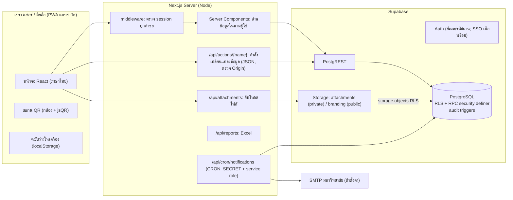
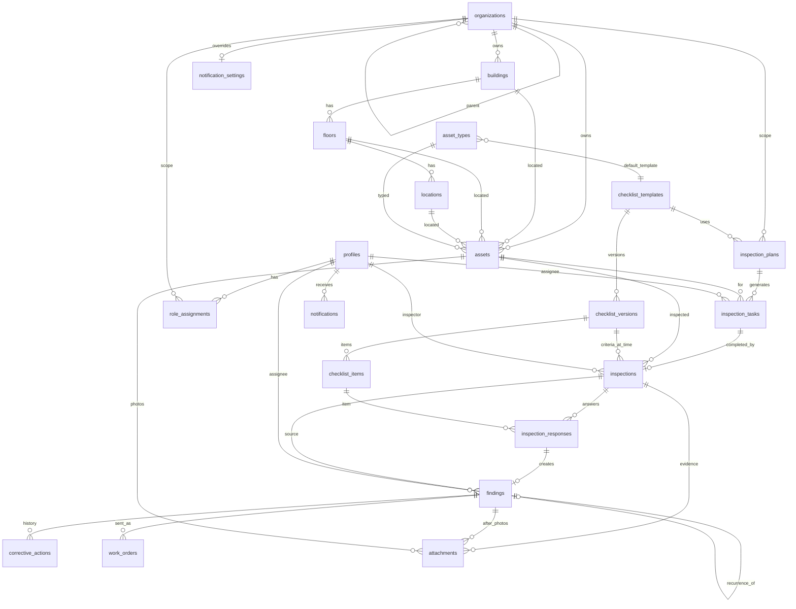

# สถาปัตยกรรมระบบ — NU Safety Inspection

## 1. สรุปความเข้าใจ

ระบบส่วนกลางของมหาวิทยาลัยสำหรับบริหารการตรวจความปลอดภัยแบบครบวงจร:

```
ทะเบียนจุดตรวจ → พิมพ์ QR → วางแผน/มอบหมาย → ตรวจหน้างาน (สแกน QR) → พบข้อบกพร่อง
→ มอบหมายผู้รับผิดชอบ → แก้ไข + หลักฐาน → ตรวจยืนยัน (ผ่าน/ส่งกลับ) → ปิดงาน → Dashboard/รายงาน
```

ผู้ใช้หลายบทบาท หลายหน่วยงาน โดยข้อมูลต้องแยกตามขอบเขตหน่วยงานและตรวจสิทธิ์ที่ฐานข้อมูลทุกครั้ง

## 2. สมมติฐาน (เปลี่ยนได้ — แจ้งไว้ตรงไปตรงมา)

| เรื่อง | สมมติฐานที่ใช้ | เปลี่ยนได้ที่ |
|---|---|---|
| โครงสร้างหน่วยงาน | มหาวิทยาลัย (ราก) → คณะ/กอง/ศูนย์ → หน่วยย่อย (ลึกได้ไม่จำกัด) | ตั้งค่าระบบ › หน่วยงาน |
| ขอบเขตสิทธิ์ | บทบาทที่หน่วยงาน X มีผลกับ X และหน่วยงานลูกทั้งหมด; บทบาทส่วนกลางกำหนดที่ราก | ตั้งค่าระบบ › ผู้ใช้และสิทธิ์ |
| ข้อมูลตำแหน่ง (อาคาร/ชั้น/ห้อง) | ผู้ใช้ที่เข้าสู่ระบบทุกคนอ่านได้ (ไม่ใช่ข้อมูลลับ) แต่แก้ไขได้ตามขอบเขต | `supabase/migrations/…_rls_policies.sql` |
| ผู้รับผิดชอบแก้ไข | ต้องมีบทบาท `responsible`; มอบหมายข้ามหน่วยงานได้ (เช่น ช่างกองอาคารสถานที่) และผู้รับผิดชอบเห็นเฉพาะงานที่ได้รับมอบหมาย | RPC `assign_finding` |
| การตรวจยืนยัน | ผู้ที่ส่งผลแก้ไข/ผู้รับผิดชอบ ยืนยันงานตนเองไม่ได้ (แยกหน้าที่) | RPC `verify_finding` |
| รอบตรวจ | งานครบกำหนดวันสุดท้ายของรอบ หรือภายใน N วันนับจากเริ่มรอบ | แผนการตรวจ |
| ความเร่งด่วน "เร่งด่วน" | ระดับ `high` (สูง) และ `critical` (วิกฤต) | `v_findings.is_urgent_open` |
| ข้อบกพร่องเกิดซ้ำ | จุดตรวจเดิม + หัวข้อตรวจเดิม ภายใน 365 วัน | RPC `submit_inspection` |
| เขตเวลา | เก็บ `timestamptz` (UTC) ทั้งหมด; “วันนี้”/วันที่รายงานตีความตาม Asia/Bangkok; แสดงปี พ.ศ. | `app.today()`, `lib/format.ts` |
| ปีงบประมาณ | 1 ต.ค. – 30 ก.ย. | `lib/format.ts presetRange` |
| ตรามหาวิทยาลัย | ไม่สร้างขึ้นเอง ผู้ดูแลอัปโหลดไฟล์ทางการ (ไม่มี = แสดงอักษร “NU”) | ตั้งค่าระบบ › ภาพลักษณ์ |
| เกณฑ์ในแบบตรวจตัวอย่าง | ทั้งหมดเป็น “ร่างสำหรับผู้เชี่ยวชาญตรวจรับรอง” ไม่อ้างกฎหมาย/มาตรฐาน | แบบตรวจ › ข้อมูลเวอร์ชัน |

## 3. การเลือกเทคโนโลยี

ใช้ตามข้อกำหนด: **Next.js 15 (App Router) + TypeScript + Tailwind CSS + Supabase (PostgreSQL, Auth, Storage)**

> ไฟล์ที่แนบมา (`server.js`, `package.json`, SQL `faculties/users/inspection_reports/audit_logs`, โครงสร้าง Express) เป็นโครง Express + `pg` + JWT ทำเอง
> ระบบนี้ **ไม่ได้ต่อยอดโค้ดชุดนั้น** เพราะข้อกำหนดระบุ Next.js + Supabase และโครงเดิมยังไม่มีตรวจสิทธิ์ระดับฐานข้อมูล (RLS), ไม่มี Storage แบบ private และเก็บรหัสผ่านเอง
> แนวคิดในไฟล์เดิมถูกนำมาครอบคลุมแล้ว: หน่วยงาน/กลุ่มคณะ → `organizations` (ลำดับชั้น), สิทธิ์รายคณะ/ส่วนกลาง → `role_assignments`, สถานะคณะ/ส่วนกลาง → สถานะงานแก้ไข + ใบงานถึงกองอาคารฯ, `audit_logs` → trigger บันทึกทุกตาราง, รูปแบบ JSON response มาตรฐาน → `ActionResult { ok, code, message, details }`

## 4. ภาพรวมสถาปัตยกรรม



**หลักความปลอดภัย**

1. ทุกคำขอจากหน้าจอใช้ session ของผู้ใช้ (anon key + JWT) → RLS มีผลทุกคำสั่ง — ไม่มีการใช้ service role แทนผู้ใช้
2. ตารางเชิงกระบวนการ (`inspections`, `inspection_responses`, `findings`, `corrective_actions`, `work_orders`, `attachments`, `role_assignments`) **ห้ามเขียนตรง** (revoke) — เขียนผ่าน RPC `security definer` ที่ตรวจสิทธิ์และสถานะในฟังก์ชันเสมอ
3. trigger ป้องกันการข้ามลำดับสถานะ และ check constraint ห้ามปิดงานโดยไม่มีผู้ตรวจยืนยัน (มีผลแม้ผู้ดูแลฐานข้อมูลแก้ตรง)
4. เมนูที่ซ่อนตามบทบาทเป็นเพียงความสะดวก — หน้าทุกหน้าตรวจสิทธิ์ซ้ำ และข้อมูลถูกกรองด้วย RLS
5. ไฟล์แนบอยู่ใน bucket private เข้าถึงผ่าน signed URL อายุ 10 นาที ซึ่งสร้างในนามผู้ใช้ (storage policy ตรวจสิทธิ์รายการต้นทาง)
6. service role ใช้เพียง 2 ที่: สร้างบัญชี Auth (หลังตรวจสิทธิ์ผู้เรียกด้วย RPC `i_can_manage_org`) และงานแจ้งเตือนตามเวลา
7. QR Code เก็บเพียง URL `/q/{qr_token}` (สุ่ม 18 hex, ถาวร, ไม่มีข้อมูลส่วนบุคคล) — ต้องเข้าสู่ระบบและผ่าน RLS ก่อนเห็นรายละเอียด
8. คำสั่งเปลี่ยนแปลงข้อมูลตรวจ `Origin` (กัน CSRF) และ cookie session เป็น SameSite=Lax

> หมายเหตุทางเทคนิค: คำสั่งเปลี่ยนแปลงข้อมูลเรียกผ่าน Route Handler `/api/actions/{name}` แทน Server Action โดยตรง เนื่องจากระหว่างทดสอบ E2E พบว่า Next.js 15 client router บางครั้งยกเลิกการนำทางต่อเนื่องหลัง Server Action ทำให้ปุ่มค้างสถานะ “กำลังบันทึก” (ข้อมูลถูกบันทึกแล้วแต่ผู้ใช้ไม่เห็นผล) — รูปแบบปัจจุบันคือ fetch → ได้ผลยืนยันจาก Backend → โหลดหน้าใหม่พร้อมข้อความยืนยัน

## 5. แผนผังหน้าจอ (Sitemap)

```
/login                              เข้าสู่ระบบ (อีเมล; ปุ่ม SSO แสดงเมื่อตั้งค่าแล้ว)
/                                   แดชบอร์ด (ตัวกรอง, KPI คลิกได้, กราฟ, ตารางรายปี, กิจกรรมล่าสุด)
/tasks                              แผนและงานตรวจ (สถานะ, มอบหมายผู้ตรวจแบบกลุ่ม)
  /plans                            แผนการตรวจ (สร้างแผน, สร้างงานถึงสิ้นปี, เปิด/ปิด)
/inspect                            เริ่มตรวจ / สแกน QR / งานของฉัน / ฉบับร่างค้าง
  /inspect/start?asset=&task=       เปิด (หรือกลับไป) ฉบับร่าง
  /inspect/{inspectionId}           แบบบันทึกผลตรวจ (มือถือ)
/inspections/{id}                   ผลตรวจที่ส่งแล้ว (อ่านอย่างเดียว)
/q/{qrToken}                        ปลายทาง QR (ต้องเข้าสู่ระบบ + มีสิทธิ์)
/assets                             ทะเบียนจุดตรวจ (ค้นหา, ใกล้หมดอายุ, เลือกพิมพ์ QR)
  /assets/new, /assets/{id}, /assets/{id}/edit, /assets/qr?id=…
/findings                           ติดตามแก้ไข (แท็บสถานะ/เกินกำหนด/เร่งด่วน/เกิดซ้ำ)
  /findings/{id}                    รายละเอียด, ลำดับสถานะ, หลักฐานก่อน–หลัง, ประวัติ, แผงดำเนินการตามบทบาท
  /findings/{id}/work-order/{wo}    ใบงาน (พิมพ์/PDF)
/reports                            Excel/PDF 5 ชนิด + ตารางรายปีรายอุปกรณ์
  /reports/print/{type}, /reports/print/{inspection|asset|finding}/{id}, /reports/annual
/notifications                      การแจ้งเตือนในระบบ
/settings                           ตั้งค่าระบบ
  /organizations /locations /users /checklists /checklists/{id} /notifications /branding /audit
```

## 6. ER Diagram



ตารางทั้งหมด (ตามข้อกำหนด + เพิ่มเติม): `organizations, buildings, floors, locations, asset_types, assets, profiles, role_assignments, checklist_templates, checklist_versions, checklist_items, inspection_plans, inspection_tasks, inspections, inspection_responses, findings, corrective_actions, work_orders, attachments, notifications, notification_settings, app_settings, audit_logs`

Views (security invoker): `v_inspection_tasks, v_findings, v_assets, v_inspections`

## 7. RPC หลัก

| ฟังก์ชัน | ผู้เรียก | หน้าที่และการป้องกัน |
|---|---|---|
| `start_inspection(asset, task?)` | ผู้ตรวจ/ผู้ดูแล | เปิดฉบับร่าง (idempotent), ผูกงานที่ถึงรอบอัตโนมัติเมื่อสแกน QR, ตรึงเวอร์ชันแบบตรวจ |
| `save_inspection_draft` | เจ้าของร่าง | บันทึกร่าง (ห้ามหลังส่ง) |
| `submit_inspection(…, client_submission_id)` | เจ้าของร่าง | ล็อกแถว, ตรวจครบทุกข้อ, NA ต้องมีเหตุผล, ไม่ผ่านต้องมีรายละเอียด+ความเร่งด่วน+ภาพหรือเหตุผลยกเว้น, คำนวณคะแนนไม่นับ NA, สร้างข้อบกพร่อง+ตรวจเกิดซ้ำ, ปิดงานตรวจ, แจ้งเตือน; ส่งซ้ำด้วยคำขอเดิมคืนผลเดิม คำขอใหม่ถูกปฏิเสธ |
| `assign_finding` | ผู้ดูแลหน่วยงาน/ส่วนกลาง | ต้องมีบทบาท responsible, กำหนดเสร็จไม่ย้อนหลัง |
| `start_corrective_work`, `add_corrective_progress`, `submit_corrective_fix` | ผู้รับผิดชอบ | ส่งผลต้องมีภาพหลังแก้ไขใหม่ (หลังมอบหมาย/ส่งกลับล่าสุด) หรือเหตุผลยกเว้น |
| `verify_finding(approve, note)` | ผู้ตรวจยืนยัน | เฉพาะสถานะรอตรวจยืนยัน, ห้ามยืนยันงานตนเอง, ส่งกลับต้องมีเหตุผล |
| `create_work_order` | ผู้ดูแล/ผู้รับผิดชอบ | ใบงาน `integration_status = not_connected` |
| `generate_inspection_tasks` | ผู้ดูแล | สร้างงานตามรอบ ไม่ซ้ำ (unique) จำกัด 400 วันล่วงหน้า |
| `create_checklist_version`, `publish_checklist_version` | ผู้ดูแลแบบตรวจ | เวอร์ชันที่เผยแพร่แก้ไม่ได้ (trigger) |
| `grant_role`, `revoke_role`, `set_profile_admin`, `claim_new_profile` | ผู้ดูแล | กันยกระดับสิทธิ์ข้ามขอบเขต |
| `dashboard_*` | ทุกคน | security invoker → ผลลัพธ์ตาม RLS |
| `run_notification_jobs` | service role (cron) | ใกล้/เกินกำหนด + ยกระดับ, กันซ้ำด้วย `dedupe_key` |

## 8. PWA — ขอบเขตที่รองรับจริง

| รองรับ | ยังไม่รองรับ |
|---|---|
| ติดตั้งเป็นแอปบนหน้าจอโฮม (manifest), แคชไฟล์คงที่ | **ส่งผลตรวจแบบออฟไลน์ / ซิงก์อัตโนมัติ** |
| แถบแจ้ง “ไม่มีการเชื่อมต่อเครือข่าย” ทุกหน้า | อัปโหลดภาพขณะออฟไลน์ |
| แบบตรวจเก็บสำเนาที่กรอกไว้ใน localStorage ทุกครั้งที่แก้ไข และกู้คืนอัตโนมัติ | เปิดหน้าที่ยังไม่เคยโหลดขณะออฟไลน์ (แสดงหน้า offline.html) |
| บันทึกร่างเข้าระบบอัตโนมัติทุก 20 วินาทีเมื่อออนไลน์ | |
| ปุ่มส่งออฟไลน์ → แจ้งชัดว่า “ยังไม่ได้ส่ง” ไม่แสดงว่าสำเร็จ | |
